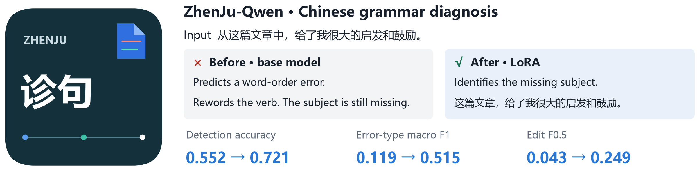
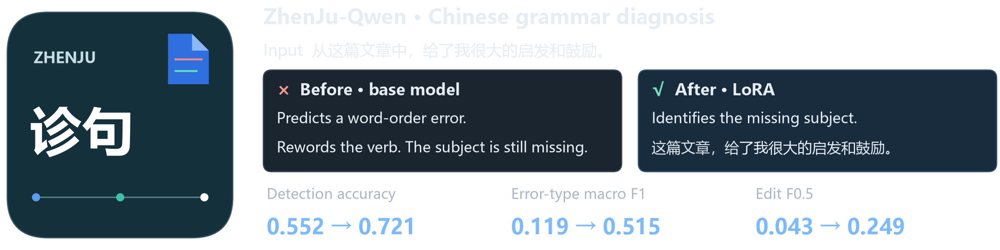

<h1 align="center">ZhenJu-Qwen · 诊句</h1>

<p align="center"><strong>Detect, classify, and correct grammatical errors in Chinese</strong></p>

<p align="center">
  <a href="https://huggingface.co/Qwen/Qwen3-1.7B"></a>
  
  <a href="https://github.com/xlxwalex/FCGEC"></a>
  <a href="LICENSE"></a>
</p>

<p align="center">
  <a href="README.md">简体中文</a> · <strong>English</strong>
  <br>
  <a href="#quick-start">Quick start</a> · <a href="#evaluation">Evaluation</a> · <a href="docs/index.html">Prediction explorer</a>
</p>

<p align="center">
  <a href="figures/hero_en.png#gh-light-mode-only"></a>
  <a href="figures/hero_en-dark.png#gh-dark-mode-only"></a>
</p>

ZhenJu uses LoRA and FCGEC to adapt Qwen3-1.7B for Chinese grammatical error diagnosis. Each response gives a verdict, an error type, an edit explanation, and a corrected sentence on four lines. Compare the base and tuned models in Gradio, or filter test-set predictions by error type in the offline explorer.

## Example diagnosis

> 从这篇文章中，给了我很大的启发和鼓励。

The tuned model identifies the missing subject. Removing 从 and 中 lets 这篇文章 serve as the subject. Here is its verbatim test-set response.

```text
判断：病句
类型：成分残缺
修改：删去“从”；删去“中”
改正：这篇文章，给了我很大的启发和鼓励。
```

## Quick start

Run these commands from the repository root with Python 3.12 and a BF16-capable NVIDIA CUDA GPU. Single-sentence inference uses about 6 GB of VRAM. The repository includes the LoRA adapter, and the first run downloads the Qwen3-1.7B base model. The PyTorch command below uses CUDA 13.2.

```bash
python -m pip install torch==2.15.0 --index-url https://download.pytorch.org/whl/cu132
python -m pip install -r requirements.txt
python -I scripts/diagnose.py --base Qwen/Qwen3-1.7B "从这篇文章中，给了我很大的启发和鼓励。"
```

Launch the Gradio demo and open `http://127.0.0.1:7860` to compare the base and tuned models side by side.

```bash
python -I scripts/app.py --base Qwen/Qwen3-1.7B --adapter adapters/zhenju-sft
```

## Evaluation

On **1,998 labeled sentences** retained from the official FCGEC validation split, LoRA instruction tuning raised detection accuracy from **55.2% to 72.1%** while updating about 1% of the model parameters.

| Model | Detection accuracy | Error-type macro F1 | Edit F0.5 |
|:--|--:|--:|--:|
| Qwen3-1.7B · zero-shot | 0.552 | 0.119 | 0.043 |
| Qwen3-1.7B · few-shot | 0.507 | 0.048 | 0.081 |
| **Qwen3-1.7B + LoRA instruction tuning** | **0.721** | **0.515** | **0.249** |
| LoRA + DPO | 0.677 | 0.431 | 0.305 |
| LoRA + PPO · rubric reward | 0.702 | 0.458 | 0.302 |
| LoRA + PPO · similarity reward | 0.721 | 0.495 | 0.246 |

DPO and rubric-reward PPO raised character-level edit F0.5, with detection recall falling from 0.731 to 0.480 and 0.582, respectively. Each row reports a single run. The full comparisons, metric definitions, and reproduction commands are in the [experiment notes](docs/details.md).

## Project materials

| Resource | Contents |
|:--|:--|
| [Prediction explorer](docs/index.html) | Download the HTML and open it locally to filter and compare model outputs |
| [Gradio preview](figures/demo.png) | Side-by-side diagnoses from the base and tuned models with highlighted edits |
| [LoRA model card](adapters/zhenju-sft/README.md) | Adapter, training configuration, and response format |
| [Evaluation results](results/) | Aggregate metrics, sentence-level predictions, and training logs |
| [Training and evaluation scripts](scripts/) | Data preparation, LoRA, BERT, DPO, PPO, and evaluation |

The code is licensed under Apache-2.0. Third-party model and corpus credits are listed in the project notice. [LICENSE](LICENSE) · [NOTICE](NOTICE)
