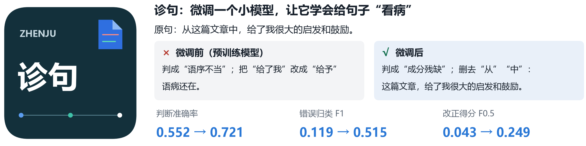
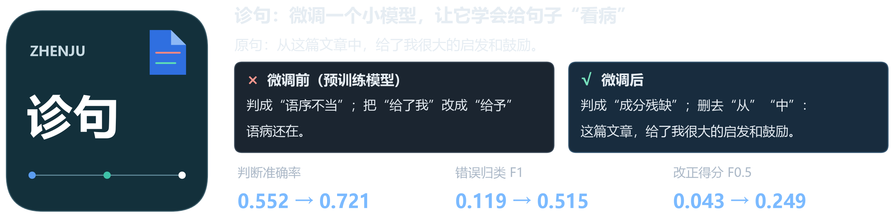

<h1 align="center">诊句 · ZhenJu-Qwen</h1>

<p align="center"><strong>中文病句检测、归类与改正</strong></p>

<p align="center">
  <a href="https://huggingface.co/Qwen/Qwen3-1.7B"></a>
  
  <a href="https://github.com/xlxwalex/FCGEC"></a>
  <a href="LICENSE"></a>
</p>

<p align="center">
  <strong>简体中文</strong> · <a href="README.en.md">English</a>
  <br>
  <a href="#快速试用">快速试用</a> · <a href="#实验结果">实验结果</a> · <a href="docs/index.html">逐句评测</a>
</p>

<p align="center">
  <a href="figures/hero.png#gh-light-mode-only"></a>
  <a href="figures/hero-dark.png#gh-dark-mode-only"></a>
</p>

诊句在 FCGEC 上用 LoRA 微调 Qwen3-1.7B，让模型按「判断 → 类型 → 修改 → 改正」四行输出。你可以在 Gradio 界面并排比较基础模型和微调模型，也可以在逐句评测浏览器中查看预测、筛选语病类型和核对改正结果。

## 一次诊断

> 从这篇文章中，给了我很大的启发和鼓励。

LoRA 模型识别出主语残缺，并把「这篇文章」恢复为句子的主语。下面是它在测试集上的原始输出。

```text
判断：病句
类型：成分残缺
修改：删去“从”；删去“中”
改正：这篇文章，给了我很大的启发和鼓励。
```

## 快速试用

在仓库根目录执行以下命令。推理环境为 Python 3.12 和支持 BF16 的 NVIDIA CUDA 显卡，单句推理约需 6 GB 显存。仓库附带 LoRA 适配器，首次运行会下载 Qwen3-1.7B 基础模型。PyTorch 安装命令以 CUDA 13.2 为例。

```bash
python -m pip install torch==2.15.0 --index-url https://download.pytorch.org/whl/cu132
python -m pip install -r requirements.txt
python -I scripts/diagnose.py --base Qwen/Qwen3-1.7B "从这篇文章中，给了我很大的启发和鼓励。"
```

启动 Gradio，在浏览器打开 `http://127.0.0.1:7860` 并排比较基础模型与微调模型。

```bash
python -I scripts/app.py --base Qwen/Qwen3-1.7B --adapter adapters/zhenju-sft
```

## 实验结果

在 FCGEC 官方验证集保留的 **1,998 句**上，LoRA 指令微调将检测准确率从 **55.2% 提升到 72.1%**。训练更新了约 1% 的模型参数。

| 模型 | 检测准确率 | 类型 Macro-F1 | 改正 F0.5 |
|:--|--:|--:|--:|
| Qwen3-1.7B · 零样本 | 0.552 | 0.119 | 0.043 |
| Qwen3-1.7B · 少样本 | 0.507 | 0.048 | 0.081 |
| **Qwen3-1.7B + LoRA 指令微调** | **0.721** | **0.515** | **0.249** |
| LoRA + DPO | 0.677 | 0.431 | 0.305 |
| LoRA + PPO · 量规奖励 | 0.702 | 0.458 | 0.302 |
| LoRA + PPO · 相似度奖励 | 0.721 | 0.495 | 0.246 |

DPO 和量规奖励 PPO 提高了字符级改正 F0.5，检测召回率则从 0.731 分别降至 0.480 和 0.582。表中每种设置对应一次运行。完整对照、评测口径和复现命令见[实验细节](docs/details.md)。

## 项目入口

| 入口 | 内容 |
|:--|:--|
| [逐句结果浏览器](docs/index.html) | 下载 HTML 后在浏览器打开，筛选并比较各模型的测试集输出 |
| [Gradio 界面预览](figures/demo.png) | 基础模型和微调模型的并排诊断及改动标记 |
| [LoRA 模型卡](adapters/zhenju-sft/README.md) | 适配器、训练配置和输出格式 |
| [评测数据与日志](results/) | 汇总指标、逐句预测和训练日志 |
| [训练与评测脚本](scripts/) | 数据准备、LoRA、BERT、DPO、PPO 和评测流程 |

代码采用 Apache-2.0 许可。第三方模型与语料的来源见项目声明。 [LICENSE](LICENSE) · [NOTICE](NOTICE)
