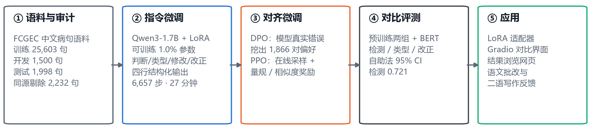
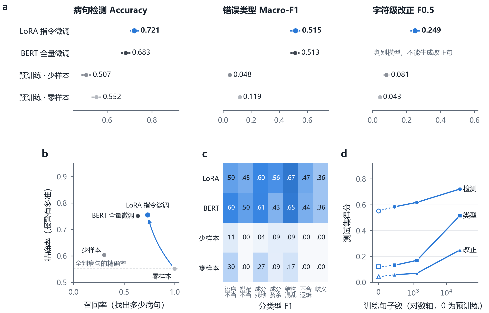
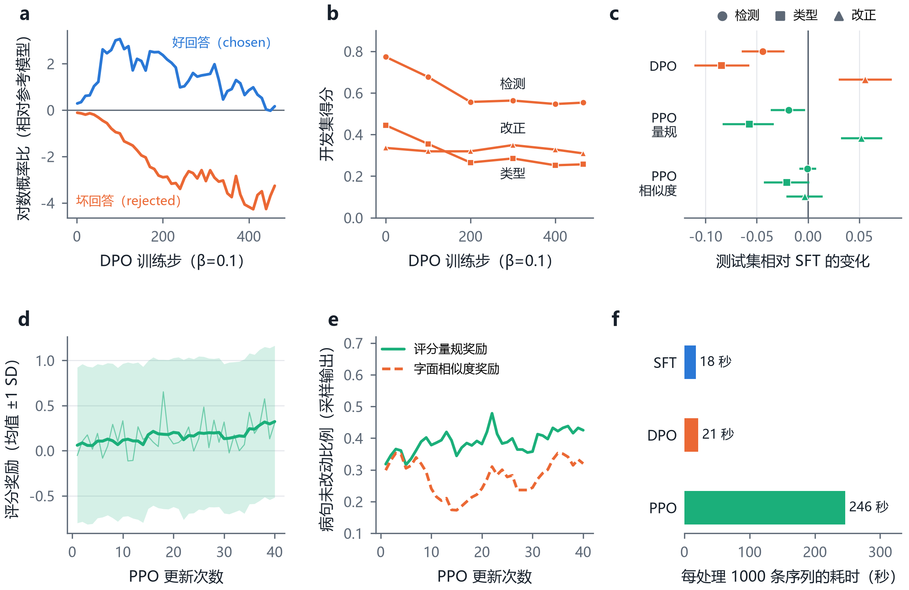
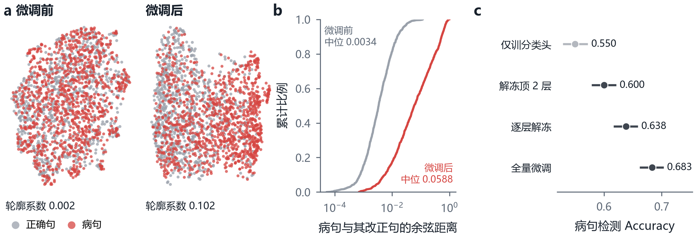

# 训练与评测

这里记录诊句的完整结果、评测口径和复现步骤。 [中文首页](../README.md) · [English overview](../README.en.md)



## 效果


**测试集结果**（从 FCGEC 带标注的官方验证集保留 1,998 句，作为独立评测集）

| 模型 | 检测准确率 | 精确率 | 召回率 | 类型 Macro-F1 | 改正 F0.5 | 病句完全改对 |
|---|---:|---:|---:|---:|---:|---:|
| Qwen3-1.7B 预训练 · 零样本 | 0.552 | 0.551 | 0.998 | 0.119 | 0.043 | 0.031 |
| Qwen3-1.7B 预训练 · 少样本 | 0.507 | 0.604 | 0.302 | 0.048 | 0.081 | 0.048 |
| BERT 全量微调 | 0.683 | 0.751 | 0.635 | 0.513 | 不适用 | 不适用 |
| **Qwen3-1.7B + LoRA 指令微调** | **0.721** | **0.755** | **0.731** | **0.515** | **0.249** | **0.223** |
| 再加 DPO | 0.677 | 0.879 | 0.480 | 0.431 | 0.305 | 0.187 |
| 再加 PPO（量规奖励） | 0.702 | 0.826 | 0.582 | 0.458 | 0.302 | 0.217 |
| 再加 PPO（相似度奖励） | 0.721 | 0.756 | 0.728 | 0.495 | 0.246 | 0.213 |



- **指令微调提高了检测和归类表现。** LoRA 更新约 1% 的参数，单卡训练约 27 分钟。类型 Macro-F1 从 0.119 升至 0.515。
- **训练规模影响归类。** 274 句将误报率从 0.994 降至 0.650，类型 Macro-F1 达到 0.131。用约 2.6 万句训练时，该指标达到 0.515。
- **两种对齐设置提高改正分数，降低检测召回率。** DPO 和量规奖励 PPO 将改正 F0.5 提升至约 0.30，检测召回率分别从 0.731 降至 0.480 和 0.582。
- **DPO 的偏好差值与检测准确率走势相反。** 训练差值上升期间，开发集检测准确率从 0.773 降至 0.553。
- **PPO 的训练耗时主要来自采样。** 每 1,000 条序列的训练耗时约为 DPO 的 12 倍，其中约 76% 用于采样。



下载 HTML 后在浏览器中打开，按类别筛选并逐句比较模型输出。 [结果浏览器](index.html)

## 快速开始

推理和训练使用 Python 3.12 及支持 BF16 的 NVIDIA CUDA 显卡。推理约需 6 GB 显存，复现训练时峰值约 16 GB。

```bash
# 按显卡驱动选择 PyTorch 的 CUDA 版本，这里以 CUDA 13.2 为例
pip install torch==2.15.0 --index-url https://download.pytorch.org/whl/cu132
pip install -r requirements.txt

# 下载 FCGEC 语料与基础模型
python scripts/download_data.py

# 命令行诊断
python -I scripts/diagnose.py --base models/Qwen3-1.7B "从这篇文章中，给了我很大的启发和鼓励。"

# 启动对比界面，然后打开 http://127.0.0.1:7860
python -I scripts/app.py --base models/Qwen3-1.7B --adapter adapters/zhenju-sft
```

仓库附带可直接加载的 LoRA 适配器。 [模型卡](../adapters/zhenju-sft/README.md)

## 复现实验

```bash
python -I scripts/01_prepare_data.py --raw data/raw/fcgec --out data
bash scripts/run_all.sh                         # RTX 5090 上约 1.5 小时
python -I scripts/08_aggregate.py --data data
python -I scripts/09_make_figures.py --data data --embeddings runs/embeddings
python -I scripts/10_build_explorer.py --data data --dpo-arm dpo_beta0.1
python -I tests/test_core.py                    # 单元测试
```

在 Windows 上，显存用满后数据会换页到内存，速度骤降且不报错，所以脚本设置了显存上限，并按 token 数限制批大小。

## 方法

- **数据：** [FCGEC](https://github.com/xlxwalex/FCGEC) 主要来自语文考试题，含语序不当、搭配不当、成分残缺、成分赘余、结构混乱、不合逻辑、歧义 7 类语病。官方测试集没有标签，因此把带标注的官方验证集作为测试集。训练集里与它共享 8 字以上连续片段的 2,232 句也被剔除，防止同源句子泄漏。
- **指令微调：** LoRA（r=16，alpha=32），3 轮。输出固定为“判断、类型、修改、改正”四行。
- **BERT 对照：** 复现王小宇、陆鑫（2022）的结构（BERT → Dropout → Linear(768→200) → Sigmoid → 分类层），比较了只训分类头、解冻顶 2 层、逐层解冻和全量微调。
- **DPO：** 用微调模型在未见过的句子上的真实错误作为被拒回答（2,000 句挖出 1,866 对），β=0.1，466 步。
- **PPO：** 手写实现，含独立价值网络。比较了评分量规和字符相似度两种奖励，各 40 次更新。

微调还改变了 BERT 的句向量。微调前，病句和它的改正句几乎重合，微调后被明显拉开：



## 局限

- 所有结果都来自单种子的一次运行。DPO 和 PPO 只是小规模实验，不代表它们大规模训练时的最终水平。
- 改正 F0.5 用的是简化的字符级编辑指标，没有用官方 ChERRANT，数值不能直接与已发表结果对比。
- BERT 的类型分类只在真实病句上做，相当于已知句子有错；LoRA 模型要自己先判断，两者的类型 F1 不是完全相同的条件。
- 逐层解冻只跑了 5 轮，其中全部解冻只有最后 1 轮，对这个方法偏不利。
- 检测准确率约 72%，会有误报和漏判，只适合作教学辅助。作为量级参考，FCGEC 原论文中人类的检测准确率为 82.65%，最好的模型为 77.63%（切分与口径不同）。

## 仓库结构

```text
adapters/zhenju-sft/   LoRA 适配器与模型卡
src/zhenju/            数据处理、提示模板、评测指标、模型工具
scripts/               实验流水线（01–10）、命令行工具、演示程序
results/               指标、预测结果、训练日志、汇总表
figures/               图（PNG / PDF / SVG）
docs/                  训练与评测说明、结果浏览网页
tests/                 单元测试
```

## 致谢与许可

代码以 [Apache-2.0](../LICENSE) 发布。[FCGEC](https://github.com/xlxwalex/FCGEC) 和 [Qwen3-1.7B](https://huggingface.co/Qwen/Qwen3-1.7B) 同为 Apache-2.0；`bert-base-chinese` 来自 Google。详见 [NOTICE](../NOTICE)。

主要参考文献：

1. 王小宇, 陆鑫. 一种基于微调通用语言模型BERT的微博谣言检测方法. 电脑编程技巧与维护, 2022.
2. Latif E, Zhai X. Fine-tuning ChatGPT for automatic scoring. Computers and Education: Artificial Intelligence, 2024.
3. Xu L, et al. FCGEC: Fine-Grained Corpus for Chinese Grammatical Error Correction. Findings of EMNLP, 2022.
4. Hu E J, et al. LoRA: Low-Rank Adaptation of Large Language Models. ICLR, 2022.
5. Rafailov R, et al. Direct Preference Optimization. NeurIPS, 2023.
6. Schulman J, et al. Proximal Policy Optimization Algorithms. arXiv:1707.06347, 2017.
